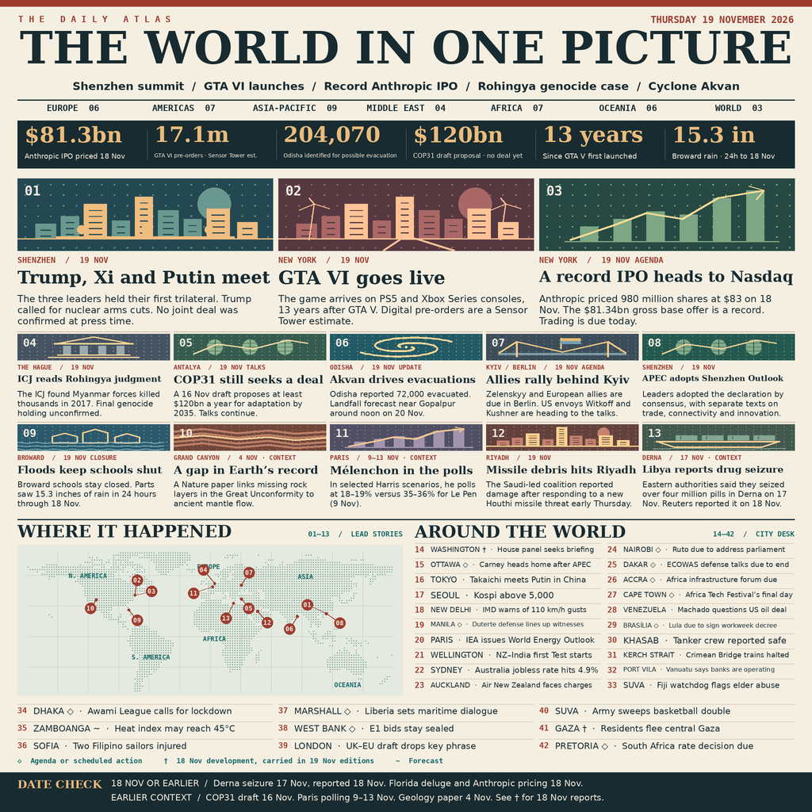

# The World in One Picture

An illustrated front page for Thursday 19 November 2026, with 42 editorial items across six inhabited continents. The edition distinguishes today's developments, scheduled events and dated background. [Source ledger](SOURCES.md)

Run the [make.fun entry](https://make.fun/bounty/news-image-20261119) with `MAKEFUN_OUTPUT_DIR=out python3 -P -s main.py`. The runner uses the Python standard library and writes the checked-in PNG unchanged.

To rebuild the artwork, run `python3 render.py` with Pillow and the DejaVu TrueType font family installed. The build retrieves the public-domain Natural Earth 1:110m land geometry at a pinned revision and checks its SHA-256. The contest runner needs neither the build dependencies nor network access.
